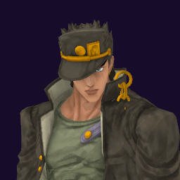

# Jotaro Kujo / Star Platinum

## Skills
| Slot | Skill | Tag | What it does |
|---|---|---|---|
| Attack (LMB / right trigger) | Ora Rush | `Skill.JTR.OraRush` | A rapid punch rush at close range. |
| Skill (Q / left trigger) | Blocking Rush | `Skill.JTR.BlockingRushSTP` | Hold to stop attacks from the front. Drains energy while you hold. |
| Ultimate (E / left grip) | The World | `Skill.JTR.TheWorldSTP` | Stops time. Everyone else freezes while you move. |

Current values: search the tag in [`balance.json`](../../balance.json).
## Original values (before our changes)
| Skill | Damage | Area | Per tick | Duration (s) | Effect (s) | Wait (s) | Energy | Range (m) | Radius (m) | Hits |
|---|---|---|---|---|---|---|---|---|---|---|
| Ora Rush | 40 | 0 | 0 | 1 | 1 | 0.5 | 120 | 6 | 0.8 | — |
| Blocking Rush | 0 | 0 | 0 | 1 | 1 | 0.8 | 0 | 6 | 0.8 | — |
| The World | 0 | 0 | 0 | 4 | 4 | 1 | 0 | 6 | 0.8 | — |
