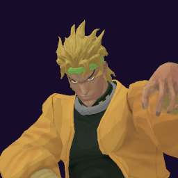

# DIO / The World

## Skills
| Slot | Skill | Tag | What it does |
|---|---|---|---|
| Attack (LMB / right trigger) | Muda Rush | `Skill.DIO.MudaRush` | A rapid punch rush at close range. |
| Skill (Q / left trigger) | Glimpse of Force | `Skill.DIO.GlimpseOfForce` | Hold to see your landing spot, release to teleport there. |
| Ultimate (E / left grip) | The World | `Skill.DIO.TheWorldWLD` | Stops time. Everyone else freezes while you move. |

Current values: search the tag in [`balance.json`](../../balance.json).
## Original values (before our changes)
| Skill | Damage | Area | Per tick | Duration (s) | Effect (s) | Wait (s) | Energy | Range (m) | Radius (m) | Hits |
|---|---|---|---|---|---|---|---|---|---|---|
| Muda Rush | 38 | 0 | 0 | 1 | 1 | 0.5 | 120 | 6.5 | 0.8 | — |
| Glimpse of Force | 0 | 0 | 0 | 1 | 1 | 0.8 | 800 | 18 | 0.8 | — |
| The World | 0 | 0 | 0 | 1.5 | 1.5 | 1 | 0 | 6 | 0.8 | — |

The World: 1.5 s is the starting time stop; the original game can extend it during a match.
