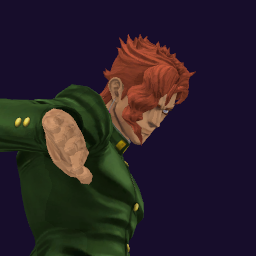

# Noriaki Kakyoin / Hierophant Green

## Skills
| Slot | Skill | Tag | What it does |
|---|---|---|---|
| Attack (LMB / right trigger) | Emerald Splash | `Skill.KKI.EmeraldSplash` | Hold to fire a stream of emeralds at long range. |
| Skill (Q / left trigger) | Separate | `Skill.KKI.Separate` | Send your Stand out and steer it. Your body stays still. Drains energy. |
| Ultimate (E / left grip) | 20 m Emerald Splash | `Skill.KKI.Radius20mEmeraldSplash` | Fires emeralds all around where you stand. Walls block them. |

Current values: search the tag in [`balance.json`](../../balance.json).
## Original values (before our changes)
| Skill | Damage | Area | Per tick | Duration (s) | Effect (s) | Wait (s) | Energy | Range (m) | Radius (m) | Hits |
|---|---|---|---|---|---|---|---|---|---|---|
| Emerald Splash | 12.5 | 0 | 0 | 1 | 1 | 0.125 | 30 | 100 | 0.8 | — |
| Separate | 0 | 0 | 0 | 60 | 1 | 0.8 | 0 | 6 | 0.8 | — |
| 20 m Emerald Splash | 5.5 | 0 | 0 | 4 | 4 | 1 | 0 | 6 | 20 | — |
