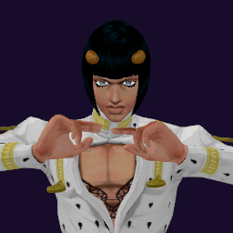

# Bruno Bucciarati / Sticky Fingers

## Skills
| Slot | Skill | Tag | What it does |
|---|---|---|---|
| Attack (LMB / right trigger) | Zip Rush | `Skill.BCT.ZipRush` | A rapid punch rush with long reach. |
| Skill (Q / left trigger) | Zipper | `Skill.BCT.Zipper` | Hold to aim at a wall, floor or ceiling, release, then walk through. |
| Ultimate (E / left grip) | Sticky Dive | `Skill.BCT.StickyDive` | Hide in a zipper: unseen, untouchable and faster. No attacks meanwhile. |

Current values: search the tag in [`balance.json`](../../balance.json).
## Original values (before our changes)
| Skill | Damage | Area | Per tick | Duration (s) | Effect (s) | Wait (s) | Energy | Range (m) | Radius (m) | Hits |
|---|---|---|---|---|---|---|---|---|---|---|
| Zip Rush | 27 | 0 | 0 | 1 | 1 | 0.5 | 120 | 14.5 | 0.6 | — |
| Zipper | 0 | 0 | 0 | 1 | 1 | 0.8 | 100 | 5 | 0.8 | — |
| Sticky Dive | 0 | 0 | 0 | 6 | 6 | 1 | 0 | 6 | 0.8 | — |
