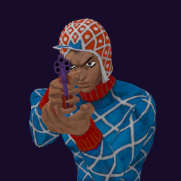

# Guido Mista / Sex Pistols

## Skills
| Slot | Skill | Tag | What it does |
|---|---|---|---|
| Attack (LMB / right trigger) | Snipe | `Skill.MST.Snipe` | Fires your gun at long range. Hold to keep shooting. |
| Skill (Q / left trigger) | Rodeo Shot | `Skill.MST.RodeoShot` | Fires a slow bullet that turns toward the enemy you aim near. |
| Ultimate (E / left grip) | Pistols Strike | `Skill.MST.PistolsStrike` | Fires a homing shot that keeps hitting all enemies around its target. |

Current values: search the tag in [`balance.json`](../../balance.json).
## Original values (before our changes)
| Skill | Damage | Area | Per tick | Duration (s) | Effect (s) | Wait (s) | Energy | Range (m) | Radius (m) | Hits |
|---|---|---|---|---|---|---|---|---|---|---|
| Snipe | 20 | 0 | 0 | 1 | 1 | 0.5 | 160 | 150 | 0.8 | — |
| Rodeo Shot | 30 | 0 | 0 | 13 | 13 | 0.8 | 500 | 130 | 0.8 | — |
| Pistols Strike | 3 | 0 | 0 | 10 | 10 | 1 | 0 | 100 | 3 | — |
