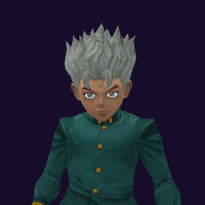

# Koichi Hirose / Echoes

## Skills
| Slot | Skill | Tag | What it does |
|---|---|---|---|
| Attack (LMB / right trigger) | Tail Rush | `Skill.KOI.TailRush` | A rapid strike with long reach. |
| Skill (Q / left trigger) | Echo Stamp | `Skill.KOI.EchoStamp` | Fires a sound stamp. A hit leaves a noise in the target's ears. |
| Ultimate (E / left grip) | Three Freeze | `Skill.KOI.ThreeFreeze` | A hit leaves the target very slow, with weak jumps and short reach. |

Current values: search the tag in [`balance.json`](../../balance.json).
## Original values (before our changes)
| Skill | Damage | Area | Per tick | Duration (s) | Effect (s) | Wait (s) | Energy | Range (m) | Radius (m) | Hits |
|---|---|---|---|---|---|---|---|---|---|---|
| Tail Rush | 22.5 | 0 | 0 | 1 | 1 | 0.5 | 120 | 14 | 0.5 | — |
| Echo Stamp | 12.5 | 0 | 0 | 5 | 5 | 0.8 | 100 | 60 | 0.8 | — |
| Three Freeze | 10 | 0 | 0 | 10 | 10 | 1 | 0 | 14 | 0.6 | — |
