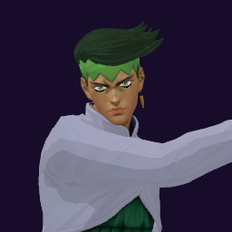

# Rohan Kishibe / Heaven's Door

## Skills
| Slot | Skill | Tag | What it does |
|---|---|---|---|
| Attack (LMB / right trigger) | Rush | `Skill.RHN.Rush` | A rapid punch rush at close range. |
| Skill (Q / left trigger) | Pink Dark | `Skill.RHN.PinkDark` | Hold to aim at a floor or wall, release to set a trap that stuns. |
| Ultimate (E / left grip) | Heaven's Lock | `Skill.RHN.HeavensLock` | A hit stuns the target and seals all their skills. |

Current values: search the tag in [`balance.json`](../../balance.json).
## Support skill
Memory Leak (G / chest + grip): Read an enemy you face to restore energy. Four reads a life. 5 m, +15% energy, then 15, 10, 10, 20 s wait.
## Original values (before our changes)
| Skill | Damage | Area | Per tick | Duration (s) | Effect (s) | Wait (s) | Energy | Range (m) | Radius (m) | Hits |
|---|---|---|---|---|---|---|---|---|---|---|
| Rush | 24 | 0 | 0 | 1 | 1 | 0.5 | 100 | 7.5 | 0.5 | — |
| Pink Dark | 10 | 0 | 0 | 300 | 1 | 0.8 | 100 | 4.5 | 0.8 | — |
| Heaven's Lock | 10 | 0 | 0 | 10 | 10 | 1 | 0 | 7.5 | 0.6 | — |
