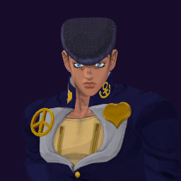

# Josuke Higashikata / Crazy Diamond

## Skills
| Slot | Skill | Tag | What it does |
|---|---|---|---|
| Attack (LMB / right trigger) | Dora Rush | `Skill.JSK.DoraRush` | A rapid punch rush at close range. |
| Skill (Q / left trigger) | Instant Wall | `Skill.JSK.InstantWall` | Hold to aim at the ground, release to raise a wall. |
| Ultimate (E / left grip) | Rage | `Skill.JSK.Rage` | Greatly cuts the damage you take for a short time. |

Current values: search the tag in [`balance.json`](../../balance.json).
## Support skill
Crazy Heal (G / chest + grip): Heal the nearest teammate in front of you (team modes) or yourself after a short wait. A hit stops it. +40 health, 3 s to heal, 45 s wait.
## Original values (before our changes)
| Skill | Damage | Area | Per tick | Duration (s) | Effect (s) | Wait (s) | Energy | Range (m) | Radius (m) | Hits |
|---|---|---|---|---|---|---|---|---|---|---|
| Dora Rush | 40 | 0 | 0 | 1 | 1 | 0.5 | 120 | 6 | 0.8 | — |
| Instant Wall | 0 | 0 | 0 | 20 | 20 | 0.8 | 20 | 5 | 0.8 | — |
| Rage | 0 | 0 | 0 | 6 | 6 | 1 | 0 | 6 | 0.8 | — |
