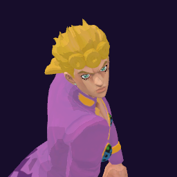

# Giorno Giovanna / Gold Experience

## Skills
| Slot | Skill | Tag | What it does |
|---|---|---|---|
| Attack (LMB / right trigger) | Muda Rush | `Skill.GRN.MudaRush` | A rapid punch rush at close range. |
| Skill (Q / left trigger) | Over Grow | `Skill.GRN.OverGrow` | Hold to aim, release to grow a tree that lifts anyone standing there. |
| Ultimate (E / left grip) | Gold Experience Requiem | `Skill.GRN.GEXRequiem` | You take no damage at all for a short time. |

Current values: search the tag in [`balance.json`](../../balance.json).
## Original values (before our changes)
| Skill | Damage | Area | Per tick | Duration (s) | Effect (s) | Wait (s) | Energy | Range (m) | Radius (m) | Hits |
|---|---|---|---|---|---|---|---|---|---|---|
| Muda Rush | 30 | 0 | 0 | 1 | 1 | 0.5 | 110 | 6 | 0.8 | — |
| Over Grow | 0 | 0 | 0 | 3 | 3 | 0.8 | 120 | 6 | 0.8 | — |
| Gold Experience Requiem | 0 | 0 | 0 | 5.5 | 5.5 | 1 | 0 | 6 | 0.8 | — |
