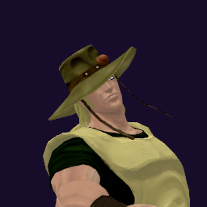

# Hol Horse / Emperor

## Skills
| Slot | Skill | Tag | What it does |
|---|---|---|---|
| Attack (LMB / right trigger) | Snipe | `Skill.HHS.Snipe` | Fires your gun at long range. Hold to keep shooting. |
| Skill (Q / left trigger) | Snake Shot | `Skill.HHS.SnakeShot` | Fires a fast bullet that turns toward the enemy you aim near. |
| Ultimate (E / left grip) | Emperor Typhoon | `Skill.HHS.EmperorTyphoon` | Fires three spread bullets nonstop. Bullets pass through enemies. |

Current values: search the tag in [`balance.json`](../../balance.json).
## Support skill
Run Away (G / chest + grip): Run much faster for a few seconds. 1.65x speed, 4 s, 15 s wait.
## Original values (before our changes)
| Skill | Damage | Area | Per tick | Duration (s) | Effect (s) | Wait (s) | Energy | Range (m) | Radius (m) | Hits |
|---|---|---|---|---|---|---|---|---|---|---|
| Snipe | 16 | 0 | 0 | 1 | 1 | 0.5 | 110 | 150 | 0.8 | — |
| Snake Shot | 11 | 0 | 0 | 1 | 1 | 0.8 | 350 | 100 | 0.8 | — |
| Emperor Typhoon | 14 | 0 | 0 | 2.15 | 2.15 | 1 | 0 | 100 | 0.8 | 25 |
