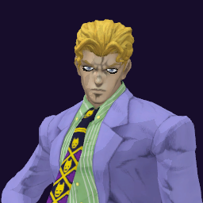

# Yoshikage Kira / Killer Queen

## Skills
| Slot | Skill | Tag | What it does |
|---|---|---|---|
| Attack (LMB / right trigger) | Killer Rush | `Skill.KIR.KillerRush` | A rapid punch rush at close range. |
| Skill (Q / left trigger) | First Bomb | `Skill.KIR.FirstBomb` | Hold to aim, release to plant a bomb. Enemies stepping close trigger it. |
| Ultimate (E / left grip) | Sheer Heart Attack | `Skill.KIR.SheerHeartAttack` | Hold to aim, release to throw. It chases the nearest enemy and explodes. |

Current values: search the tag in [`balance.json`](../../balance.json).
## Support skill
Killer Instinct (G / chest + grip): Mark enemies at 25% health or less, even through walls. 40 m, 8 s, 25 s wait.
## Original values (before our changes)
| Skill | Damage | Area | Per tick | Duration (s) | Effect (s) | Wait (s) | Energy | Range (m) | Radius (m) | Hits |
|---|---|---|---|---|---|---|---|---|---|---|
| Killer Rush | 30 | 0 | 0 | 1 | 1 | 0.5 | 120 | 7.5 | 0.8 | — |
| First Bomb | 60 | 60 | 0 | 300 | 2 | 0.8 | 200 | 5.2 | 0.8 | — |
| Sheer Heart Attack | 10 | 60 | 0 | 10 | 1 | 1 | 0 | 1000 | 6 | — |
