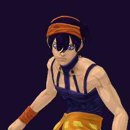

# Narancia Ghirga / Aerosmith

## Skills
| Slot | Skill | Tag | What it does |
|---|---|---|---|
| Attack (LMB / right trigger) | Bora Rush | `Skill.NRC.BoraRush` | Hold to fire a stream of bullets. Damage falls at long range. |
| Skill (Q / left trigger) | CO2 Scan | `Skill.NRC.CO2Scan` | Marks everyone around you through walls. You can hit hidden enemies. |
| Ultimate (E / left grip) | Volare Bomb | `Skill.NRC.VolareBomb` | Hold to aim, release to throw. It explodes and leaves burning ground. |

Current values: search the tag in [`balance.json`](../../balance.json).
## Original values (before our changes)
| Skill | Damage | Area | Per tick | Duration (s) | Effect (s) | Wait (s) | Energy | Range (m) | Radius (m) | Hits |
|---|---|---|---|---|---|---|---|---|---|---|
| Bora Rush | 5 | 0 | 0 | 1 | 1 | 0.094 | 30 | 100 | 0.8 | — |
| CO2 Scan | 0 | 0 | 0 | 3 | 3 | 0.8 | 200 | 30 | 30 | — |
| Volare Bomb | 10 | 40 | 4.5 | 0.6 | 0.6 | 1 | 0 | 1000 | 6 | — |
