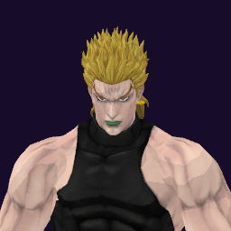

# DIO (High) / The World

## Skills
| Slot | Skill | Tag | What it does |
|---|---|---|---|
| Attack (LMB / right trigger) | WRY Rush | `Skill.DOH.WRYRush` | A rapid punch rush at close range. |
| Skill (Q / left trigger) | Glimpse of Force | `Skill.DOH.GlimpseOfForce` | Hold to see your landing spot, release to teleport there. |
| Ultimate (E / left grip) | Road Roller | `Skill.DOH.RoadRoller` | Hold to aim, release. Stops time, then a road roller hits one enemy. |

Current values: search the tag in [`balance.json`](../../balance.json).
## Original values (before our changes)
| Skill | Damage | Area | Per tick | Duration (s) | Effect (s) | Wait (s) | Energy | Range (m) | Radius (m) | Hits |
|---|---|---|---|---|---|---|---|---|---|---|
| WRY Rush | 45 | 0 | 0 | 1 | 1 | 0.5 | 130 | 6 | 0.8 | — |
| Glimpse of Force | 0 | 0 | 0 | 1 | 1 | 0.8 | 450 | 18 | 0.8 | — |
| Road Roller | 120 | 0 | 0 | 2.5 | 2.5 | 1 | 0 | 6 | 15 | — |
