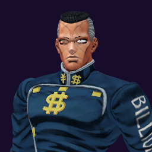

# Okuyasu Nijimura / The Hand

## Skills
| Slot | Skill | Tag | What it does |
|---|---|---|---|
| Attack (LMB / right trigger) | Rush | `Skill.OKY.Rush` | A rapid punch rush at close range. |
| Skill (Q / left trigger) | Space Shaving | `Skill.OKY.SpaceShaving` | Hold to aim, release. Pulls the first enemy in reach right up to you. |
| Ultimate (E / left grip) | Bring It On | `Skill.OKY.BringItOn` | Cuts the damage you take for a short time. |

Current values: search the tag in [`balance.json`](../../balance.json).
## Original values (before our changes)
| Skill | Damage | Area | Per tick | Duration (s) | Effect (s) | Wait (s) | Energy | Range (m) | Radius (m) | Hits |
|---|---|---|---|---|---|---|---|---|---|---|
| Rush | 28 | 0 | 0 | 1 | 1 | 0.5 | 105 | 5 | 0.8 | — |
| Space Shaving | 0 | 0 | 0 | 0.4 | 0.4 | 0.8 | 380 | 11.3 | 0.25 | — |
| Bring It On | 0 | 0 | 0 | 6 | 6 | 1 | 0 | 6 | 0.8 | — |
