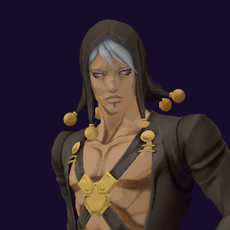

# Risotto Nero / Metallica

## Skills
| Slot | Skill | Tag | What it does |
|---|---|---|---|
| Attack (LMB / right trigger) | Blade Generation | `Skill.RST.BladeGeneration` | Throws a blade. Damage falls at long range. Hold to keep throwing. |
| Skill (Q / left trigger) | Ironsand Camouflage | `Skill.RST.IronsandCamouflage` | Blend into the scenery. Direct attacks miss you. Drains energy. |
| Ultimate (E / left grip) | Invasion of Metallica | `Skill.RST.InvasionOfMetallica` | Hold to aim, release. Poisons and slows the first enemy in reach. |

Current values: search the tag in [`balance.json`](../../balance.json).
## Original values (before our changes)
| Skill | Damage | Area | Per tick | Duration (s) | Effect (s) | Wait (s) | Energy | Range (m) | Radius (m) | Hits |
|---|---|---|---|---|---|---|---|---|---|---|
| Blade Generation | 20 | 0 | 0 | 1 | 1 | 0.5 | 65 | 75 | 0.8 | — |
| Ironsand Camouflage | 0 | 0 | 0 | 20 | 1 | 0.8 | 0 | 6 | 0.8 | — |
| Invasion of Metallica | 0 | 0 | 13 | 7 | 7 | 1 | 0 | 6 | 0.2 | — |
