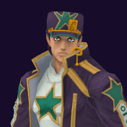

# Jotaro (Stone Ocean) / Star Platinum (SO)

## Skills
| Slot | Skill | Tag | What it does |
|---|---|---|---|
| Attack (LMB / right trigger) | Ora Rush | `Skill.JR6.OraRush` | A rapid punch rush at close range. |
| Skill (Q / left trigger) | Blocking Rush | `Skill.JR6.BlockingRushSP6` | Hold to stop attacks from the front. Drains energy while you hold. |
| Ultimate (E / left grip) | The World | `Skill.JR6.TheWorldSP6` | Stops time. Everyone else freezes while you move. |

Current values: search the tag in [`balance.json`](../../balance.json).
## Original values (before our changes)
| Skill | Damage | Area | Per tick | Duration (s) | Effect (s) | Wait (s) | Energy | Range (m) | Radius (m) | Hits |
|---|---|---|---|---|---|---|---|---|---|---|
| Ora Rush | 30 | 0 | 0 | 1 | 1 | 0.5 | 120 | 7 | 0.8 | — |
| Blocking Rush | 0 | 0 | 0 | 1 | 1 | 0.8 | 0 | 6 | 0.8 | — |
| The World | 0 | 0 | 0 | 1.75 | 1.75 | 1 | 450 | 6 | 0.8 | — |

The World: 1.75 s is the starting time stop; the original game can extend it during a match.
