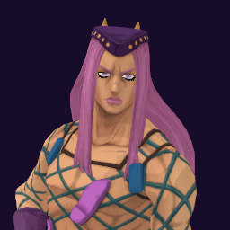

# Narciso Anasui / Diver Down

## Skills
| Slot | Skill | Tag | What it does |
|---|---|---|---|
| Attack (LMB / right trigger) | Diver Rush | `Skill.ANS.DiverRush` | A rapid punch rush at close range. |
| Skill (Q / left trigger) | Diver Shoot | `Skill.ANS.DiverShoot` | A single heavy strike with long reach and a wide hit area. |
| Ultimate (E / left grip) | Assault Dive | `Skill.ANS.AssaultDive` | Your Stand crosses the floor to your aim and shreds enemies around it. |

Current values: search the tag in [`balance.json`](../../balance.json).
## Support skill
Wall Climb (G / chest + grip): Climb the wall in front of you and over the top. up to 4 s, 6 s wait.
## Original values (before our changes)
| Skill | Damage | Area | Per tick | Duration (s) | Effect (s) | Wait (s) | Energy | Range (m) | Radius (m) | Hits |
|---|---|---|---|---|---|---|---|---|---|---|
| Diver Rush | 28 | 0 | 0 | 1 | 1 | 0.5 | 120 | 7.5 | 0.8 | — |
| Diver Shoot | 33 | 0 | 0 | 1 | 1 | 0.8 | 560 | 9 | 1.2 | — |
| Assault Dive | 3 | 0 | 0 | 10 | 10 | 1 | 0 | 6 | 2 | — |
