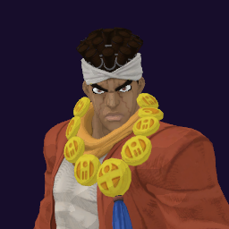

# Muhammad Avdol / Magician's Red

## Skills
| Slot | Skill | Tag | What it does |
|---|---|---|---|
| Attack (LMB / right trigger) | Cross Fire Hurricane | `Skill.ABD.CrossFireHurricane` | Fires a fireball that bursts and leaves burning ground. Hold to repeat. |
| Skill (Q / left trigger) | Red Bind | `Skill.ABD.RedBind` | Hold to aim, release. Stuns the first enemy in reach for a moment. |
| Ultimate (E / left grip) | Cross Fire Hurricane Special | `Skill.ABD.CrossFireHurricaneSpecial` | Fires a nonstop stream of fireballs. Keep aiming to steer them. |

Current values: search the tag in [`balance.json`](../../balance.json).
## Original values (before our changes)
| Skill | Damage | Area | Per tick | Duration (s) | Effect (s) | Wait (s) | Energy | Range (m) | Radius (m) | Hits |
|---|---|---|---|---|---|---|---|---|---|---|
| Cross Fire Hurricane | 10 | 15 | 4.5 | 1 | 1 | 0.35 | 250 | 100 | 3 | — |
| Red Bind | 0 | 0 | 0 | 0.8 | 0.8 | 0.8 | 400 | 8.5 | 0.25 | — |
| Cross Fire Hurricane Special | 15 | 15 | 4.5 | 3 | 3 | 1 | 0 | 100 | 3 | 30 |
