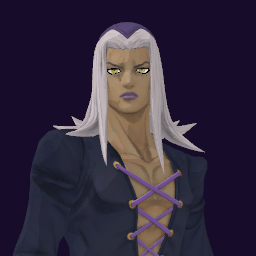

# Leone Abbacchio / Moody Blues

## Skills
| Slot | Skill | Tag | What it does |
|---|---|---|---|
| Attack (LMB / right trigger) | Moody Rush | `Skill.ABC.MoodyRush` | A punch rush. Hits harder on an enemy who struck your Dubbing clone. |
| Skill (Q / left trigger) | Dubbing | `Skill.ABC.Dubbing` | Hold to place a clone you steer. Whoever hits it takes that hit back. |
| Ultimate (E / left grip) | Gang Readiness | `Skill.ABC.GangReadiness` | Most attacks cannot finish you: your health stops at a low floor. |

Current values: search the tag in [`balance.json`](../../balance.json).
## Original values (before our changes)
| Skill | Damage | Area | Per tick | Duration (s) | Effect (s) | Wait (s) | Energy | Range (m) | Radius (m) | Hits |
|---|---|---|---|---|---|---|---|---|---|---|
| Moody Rush | 29 | 0 | 0 | 1 | 1 | 0.5 | 120 | 7.5 | 0.8 | — |
| Dubbing | 0 | 0 | 0 | 30 | 1 | 0.8 | 100 | 6 | 0.8 | — |
| Gang Readiness | 0 | 0 | 0 | 6 | 6 | 1 | 0 | 6 | 0.8 | — |
