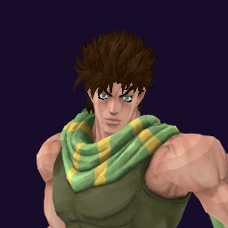

# Joseph Joestar / Hamon

## Skills
| Slot | Skill | Tag | What it does |
|---|---|---|---|
| Attack (LMB / right trigger) | Cracker Boomerang | `Skill.JSP.CrackerBoomerang` | A rapid strike with long reach. |
| Skill (Q / left trigger) | Hamon Hair Attack | `Skill.JSP.HamonHairAttack` | Hold to aim, release to set a barrier. It stops shots and hurts enemies. |
| Ultimate (E / left grip) | Overdrive | `Skill.JSP.Overdrive` | Boosts your damage and speed, and you take only 70% damage. |

Current values: search the tag in [`balance.json`](../../balance.json).
## Support skill
Run Away (G / chest + grip): Run faster for a few seconds. 1.5x speed, 4 s, 15 s wait.
## Original values (before our changes)
| Skill | Damage | Area | Per tick | Duration (s) | Effect (s) | Wait (s) | Energy | Range (m) | Radius (m) | Hits |
|---|---|---|---|---|---|---|---|---|---|---|
| Cracker Boomerang | 25 | 0 | 0 | 1 | 1 | 0.5 | 120 | 10.75 | 0.8 | — |
| Hamon Hair Attack | 0 | 0 | 2 | 20 | 1 | 0.8 | 100 | 3 | 1.2 | — |
| Overdrive | 0 | 0 | 0 | 7.5 | 7.5 | 1 | 0 | 6 | 0.8 | — |
