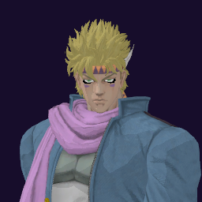

# Caesar Zeppeli / Hamon

## Skills
| Slot | Skill | Tag | What it does |
|---|---|---|---|
| Attack (LMB / right trigger) | Bubble Launcher | `Skill.CSR.BubbleLauncher` | Hold to fire bubbles that burst on contact. |
| Skill (Q / left trigger) | Bubble Cutter | `Skill.CSR.BubbleCutter` | Hold to charge, release to fire. Keep aim on an enemy and it homes in. |
| Ultimate (E / left grip) | Bubble Lens | `Skill.CSR.BubbleLens` | Fires a steady laser beam. Keep aiming to steer it. |

Current values: search the tag in [`balance.json`](../../balance.json).
## Support skill
Soul Bubble (G / chest + grip): Leave a bubble ahead. An enemy who touches it takes damage. 15 damage, lasts 20 s, 20 s wait.
## Original values (before our changes)
| Skill | Damage | Area | Per tick | Duration (s) | Effect (s) | Wait (s) | Energy | Range (m) | Radius (m) | Hits |
|---|---|---|---|---|---|---|---|---|---|---|
| Bubble Launcher | 0 | 8.4 | 0 | 1 | 1 | 0.1 | 25 | 50 | 2.25 | — |
| Bubble Cutter | 10 | 0 | 0 | 1 | 1 | 0.8 | 333 | 100 | 0.8 | — |
| Bubble Lens | 7.5 | 8.4 | 0 | 3.75 | 3.75 | 1 | 0 | 75 | 3 | 75 |
