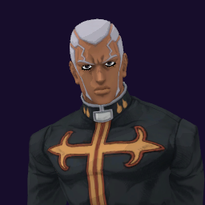

# Enrico Pucci / Whitesnake

## Skills
| Slot | Skill | Tag | What it does |
|---|---|---|---|
| Attack (LMB / right trigger) | Rush | `Skill.C28.Rush` | A rapid punch rush at close range. |
| Skill (Q / left trigger) | Rob SD | `Skill.C28.RobSd` | A hit steals their Stand: no skills and half damage. |
| Ultimate (E / left grip) | Rob MD | `Skill.C28.RobMd` | Hold to aim, release. Takes half their health and seals their ultimate. |

Current values: search the tag in [`balance.json`](../../balance.json).
## Support skill
Collect Disc (G / chest + grip): Take a disc from a defeated enemy beside you: more damage, up to three. +7% damage a disc, 2.5 m, 5 s wait.
## Original values (before our changes)
| Skill | Damage | Area | Per tick | Duration (s) | Effect (s) | Wait (s) | Energy | Range (m) | Radius (m) | Hits |
|---|---|---|---|---|---|---|---|---|---|---|
| Rush | 28 | 0 | 0 | 1 | 1 | 0.5 | 120 | 7 | 0.8 | — |
| Rob SD | 10 | 0 | 0 | 10 | 10 | 0.8 | 240 | 7 | 0.8 | — |
| Rob MD | 0 | 0 | 0 | 0.4 | 0.4 | 1 | 0 | 8.7 | 0.35 | — |
